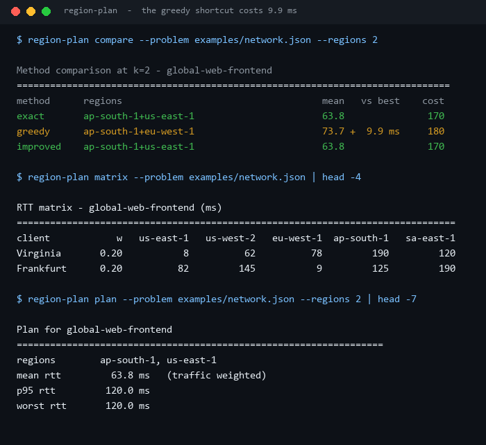
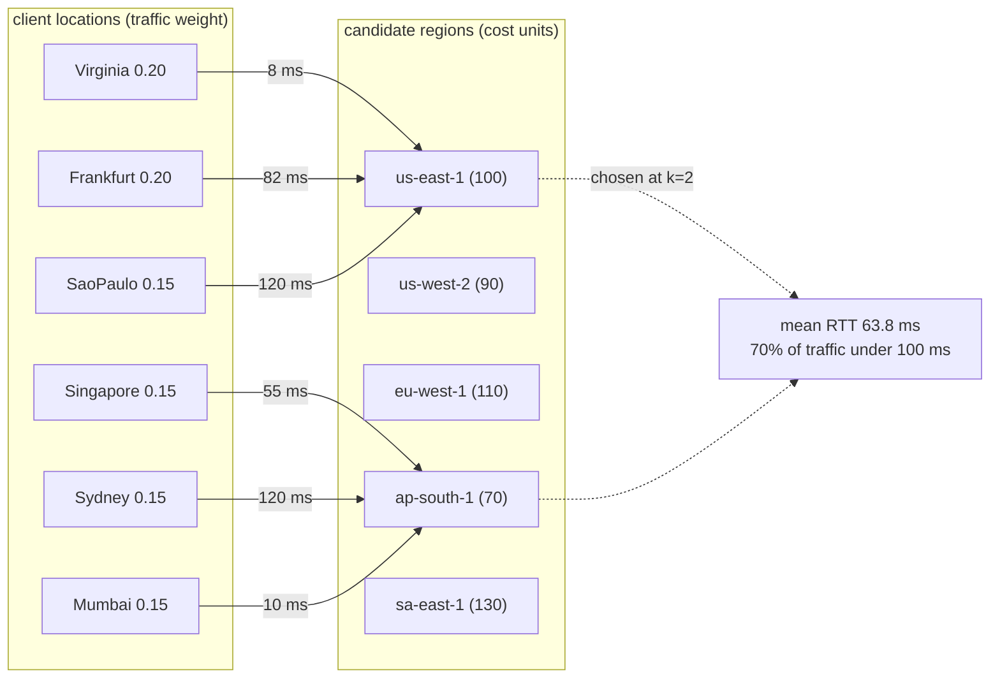
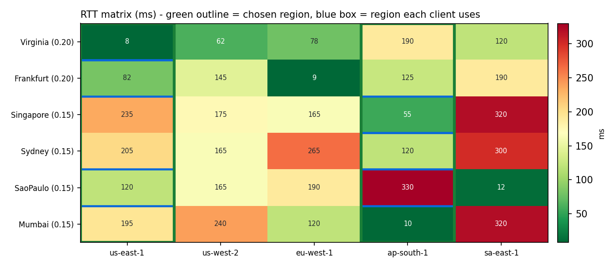
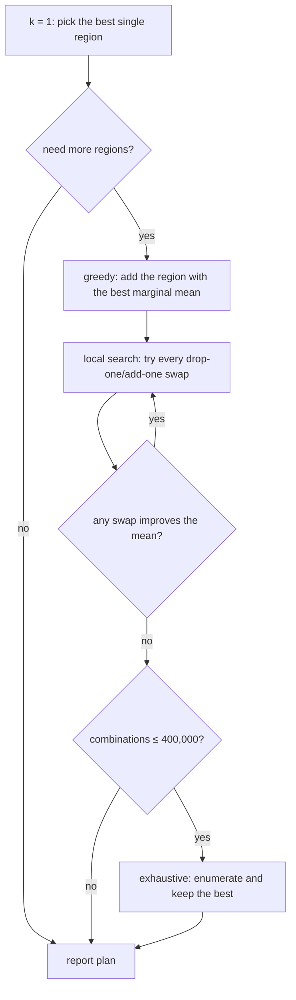
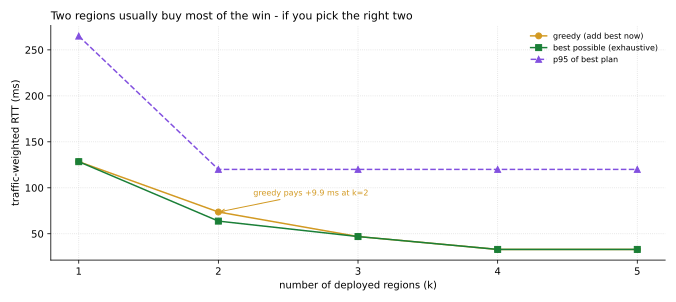

# Region-Latency-Planner

**How many regions do you need, which ones, and what does each extra one actually buy?**

You give it an RTT matrix (client location → region) and a traffic weight per client. It returns
the region set that minimises traffic-weighted latency, the marginal gain of the k-th region,
and the best set that fits a fixed cost budget.



That screenshot is real output from `scripts/render_assets.py`. The greedy row is the interesting
one: it is **9.9 ms worse** than the best possible pair, and it costs *more*.

---

## Table of contents

- [Why this exists](#why-this-exists)
- [The problem, in one picture](#the-problem-in-one-picture)
- [The greedy trap, measured](#the-greedy-trap-measured)
- [Diminishing returns, measured](#diminishing-returns-measured)
- [Budget mode is a knapsack](#budget-mode-is-a-knapsack)
- [Install and run](#install-and-run)
- [Commands](#commands)
- [The problem file format](#the-problem-file-format)
- [Metrics explained](#metrics-explained)
- [Design notes and limits](#design-notes-and-limits)
- [Tests](#tests)
- [License](#license)

---

## Why this exists

"We should deploy in more regions" is easy to say and hard to justify. The three questions that
actually get asked in the design review are:

1. **Which regions?** Not "the biggest ones" - the ones that pull the weighted average down.
2. **How many?** The second region usually buys 50% of the win; the fifth often buys nothing.
3. **What if we have a budget?** Then it stops being a coverage question and becomes a knapsack.

This tool answers all three from a matrix, with no cloud API calls and no assumptions about
provider geography - the matrix is whatever you measured.

## The problem, in one picture



Every client is served by the **closest chosen region**. The objective is the
traffic-weighted mean of those minimums - an instance of the *k-median* problem, where the
"facilities" are regions and the "demands" are clients.



Green outlines mark the two chosen regions, blue boxes mark the region each client actually
takes. Virginia and Frankfurt both use `us-east-1`; the Asian clients use `ap-south-1`.

## The greedy trap, measured

The obvious algorithm is greedy: repeatedly add the region that helps most right now. On a
symmetric world it is fine. It breaks when one region is a **compromise hub** - mediocre for
everybody, best for nobody - because that hub wins the *first* pick and greedy can never undo it.

| method | regions chosen at k=2 | mean RTT | vs best | cost |
| --- | --- | ---: | ---: | ---: |
| exhaustive (ground truth) | `ap-south-1` + `us-east-1` | **63.8 ms** | - | 170 |
| greedy (add best now) | `ap-south-1` + `eu-west-1` | 73.7 ms | **+9.9 ms** | 180 |
| greedy then single swaps | `ap-south-1` + `us-east-1` | **63.8 ms** | - | 170 |

Greedy's first pick is `eu-west-1` (best single region: 128.4 ms weighted mean). From there the
best addition is `ap-south-1`, and the pair lands at 73.7 ms. The optimal pair trades the
Europe-favouring first pick for `us-east-1`, which serves Virginia at 8 ms *and* Frankfurt at
82 ms instead of 9 ms - the sum is what matters, not either client alone.

The repair step is 20 lines of single-swap local search and it finds the optimum here. It is not
guaranteed to in general (k-median swaps can stall in a local optimum), which is why `exact` is
the default whenever the combination count is small enough to enumerate.



## Diminishing returns, measured



| k | regions | mean RTT | marginal gain | p95 | under 100 ms | cost |
| ---: | --- | ---: | ---: | ---: | ---: | ---: |
| 1 | `eu-west-1` | 128.4 ms | - | 265 ms | 40% | 110 |
| 2 | `ap-south-1` + `us-east-1` | 63.75 ms | **-64.7 ms** | 120 ms | 70% | 170 |
| 3 | + `sa-east-1` | 46.95 ms | -16.8 ms | 120 ms | 85% | 310 |
| 4 | + `eu-west-1` | 32.95 ms | -14.0 ms | 120 ms | 85% | 410 |
| 5 | + `us-west-2` | 32.95 ms | **0.0 ms** | 120 ms | 85% | 500 |

Two regions remove half the latency. The fifth region removes **nothing** - `us-west-2` is never
the closest region for any client once the other four exist, so it only adds 90 cost units. The
sweep output says `no measurable gain` for exactly that reason instead of printing `-0.0`.

Note p95 stops improving at k=2 while the mean keeps falling: the tail is Sydney (120 ms to
`ap-south-1`), and no combination of these five regions gets Sydney under 100 ms. Averaging
improves; the worst user does not. That distinction is invisible if you only track the mean.

## Budget mode is a knapsack

```bash
$ region-plan budget --problem examples/network.json --budget 130
Budget plan (limit 130 units, spent 110)
==================================================================
regions        eu-west-1
mean rtt        128.4 ms
within 100ms   40.0% of traffic
```

With 130 units you cannot afford the good pair (170 units), so the answer is one region and
128.4 ms. Greedy-by-value-per-cost would have been tempted by the cheapest region first; because
the affordable subset space here is tiny, the budget solver enumerates every affordable
combination and only falls back to the ratio heuristic above 400,000 subsets. The exhaustive
answer costs the same or less and is never worse.

## Install and run

Standard library only.

```bash
python -m pip install -e ".[dev]"
region-plan sweep --problem examples/network.json
```

From a checkout without installing:

```bash
PYTHONPATH=src python -m region_latency_planner sweep --problem examples/network.json
```

## Commands

| Command | What it answers |
| --- | --- |
| `plan --regions k [--method exact\|greedy\|improved]` | which k regions, and the per-client assignment |
| `sweep [--max-regions N]` | best plan for every k, with the marginal gain of each step |
| `compare --regions k` | exhaustive vs greedy vs local search side by side |
| `matrix` | the raw RTT matrix and region costs |
| `budget --budget X` | the best set that fits the budget |

`plan` and `budget` also take `--format json` for piping into something else:

```bash
region-plan plan --problem examples/network.json --regions 2 --format json
```

## The problem file format

```json
{
  "name": "global-web-frontend",
  "target_ms": 100,
  "regions": [{ "name": "us-east-1", "cost": 100 }],
  "clients": [
    { "name": "Virginia", "weight": 0.2, "rtt": { "us-east-1": 8 } }
  ]
}
```

- `weight` is relative traffic - shares, requests per second, or session counts all work; only
  ratios matter.
- `rtt` must cover **every** region, because a missing cell would silently make a region look
  free. Missing or unknown regions are rejected with the client name in the error.
- `cost` is in whatever unit your finance team uses (relative units here). It only ever appears
  in sums and ratios, so dollars, euros, or "capacity slots" all work.
- `target_ms` is the threshold used by the `under target` column (default 100).

Regions may also be written as bare strings (`"us-east-1"`) when cost is not modelled.

## Metrics explained

| Metric | Definition | Why it is there |
| --- | --- | --- |
| `mean rtt` | Σ(weight × nearest RTT) / Σweight | the objective being optimised |
| `p95 rtt` | RTT at the 95th percentile of weight | stops a great average hiding a bad tail |
| `worst rtt` | highest placed-client RTT | the single unhappiest user |
| `within target` | share of weight at or under `target_ms` | the number people actually quote in reviews |
| `cost` | sum of chosen region costs | the other half of the trade-off |

`p95` is computed on the **placement**, not on a traffic sample: clients are sorted by their
served RTT and walked until 95% of weight is covered. With six clients that is coarse, and the
tool does not pretend otherwise.

## Design notes and limits

- **One latency table, no modelling.** No queueing, no bandwidth, no cold starts, no
  multi-hop. If your real p95 is dominated by database round-trips, this matrix is the wrong
  input - measure end-to-end RTT per region instead of ICMP.
- **Client → nearest region only.** No capacity limits, no failover, no sticky sessions. Real
  traffic also goes to a second-choice region when the first is busy; that is a different
  (harder) objective.
- **`exact` is exponential.** It refuses above 400,000 combinations and tells you to use
  `--method greedy` rather than hanging silently.
- **`improved` means greedy + swaps**, not "guaranteed optimal". The label says what it does.
- **The example matrix is hand-entered**, representative round-trip times between common cloud
  regions and user population centres, not a measurement from this machine. Replace it with
  your own `ping`/synthetic-monitor data - the file format is the point, not the numbers.

## Tests

```bash
PYTHONPATH=src python -m pytest -q     # 51 passed
python -m ruff check .                 # All checks passed!
```

51 tests cover parsing and every rejection path, weighted-mean and weighted-p95 maths, the
greedy trap (greedy must be worse, `exact` must find the split pair, `improve` must recover it),
monotonicity of the sweep in k, budget feasibility, and every CLI exit code.

## License

MIT. See [LICENSE](LICENSE).

---

<sub>Screenshots and charts come from `scripts/render_assets.py` running this repository's own
code on `examples/network.json`. No stock images or third-party assets are used.</sub>
